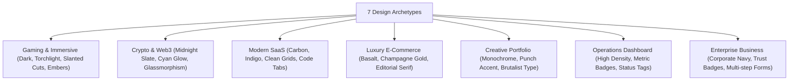

# 🚀 Antigravity Custom Skills Suite

A production-grade collection of autonomous AI engineering skills for **Google Antigravity (AGY)**, specializing in high-fidelity website reverse engineering, pixel-perfect replication, and autonomous from-scratch web application architecture.

---

## 📦 Included Skills

| Skill | Description | Primary Use Case |
| :--- | :--- | :--- |
| **[`autonomous-website-architect`](./skills/autonomous-website-architect)** | **Dual-Mode Architect**: (1) Reference-based replication from URLs/screenshots, and (2) Autonomous from-scratch design across 7 archetypes. | Complete website creation, product design, landing pages, and web apps from ideas or references. |
| **[`pixel-perfect-website-replica`](./skills/pixel-perfect-website-replica)** | **Replication Specialist**: Dedicated reverse engineering engine for exact visual cloning, asset mapping, and multi-viewport diffing. | Strict 1:1 cloning of existing websites, UI screenshots, and downloaded asset directories. |
| **[`website-asset-art-director`](./skills/website-asset-art-director)** | **Creative Art Director & Asset Pipeline**: Plans, generates, cleans, optimizes, and packages all web visual assets (characters, spritesheets, transparent cutouts, hero backdrops). | Complete asset planning, exact AI prompts, character consistency, spritesheet packaging, alpha cleansing, and web integration. |

---

## 🔌 MCP Servers: Which Ones Are Needed & How to Setup

Antigravity uses the **Model Context Protocol (MCP)** to give AI agents browser automation tools so they can launch browsers, inspect pages, and take visual screenshots.

### Which MCP Servers Are Needed?
To enable automated visual verification, screenshot capture, and layout checks:

1. **`playwright`** (Recommended): Provides browser navigation, full-page screenshots, viewport resizing, element clicking, and console error logging.
2. **`chrome-devtools`** (Alternative/Supplementary): Provides Chromium DevTools integration, DOM auditing, accessibility checks, and network inspection.

### Do I Need to Manually Install Them?
**No manual `npm install` is required!**  
Both servers run on-demand using `npx -y` (part of standard Node.js). Antigravity automatically downloads and starts the lightweight server processes in the background when needed.

### How to Add Them to Antigravity

#### Option A: Automatic Setup via Installer (Easiest)
Running `.\install.ps1` (Windows) or `./install.sh` (macOS/Linux) automatically configures both skills and merges the browser MCP servers into your `~/.gemini/config/mcp_config.json` file.

#### Option B: Manual Setup
Add the following to your global configuration file at `~/.gemini/config/mcp_config.json` (Windows: `C:\Users\<User>\.gemini\config\mcp_config.json`):

```json
{
  "mcpServers": {
    "playwright": {
      "command": "npx",
      "args": [
        "-y",
        "@playwright/mcp@latest"
      ]
    },
    "chrome-devtools": {
      "command": "npx",
      "args": [
        "-y",
        "chrome-devtools-mcp@latest"
      ]
    }
  }
}
```

A template file is included in this repository: [`mcp_config.example.json`](./mcp_config.example.json).

---

## 🛠️ System Prerequisites

| Dependency | Purpose | Verification Command |
| :--- | :--- | :--- |
| **Node.js (v18+)** | Compiles React/Vite/Next.js code and runs dev servers | `node -v` |
| **Python (3.8+)** | Runs `asset_analyzer.py` and `design_token_generator.py` (No external packages needed) | `python --version` |
| **Git** | Repository version control | `git --version` |
| **MCP Servers** | Browser screenshot & console error auditing | Enabled in `mcp_config.json` |

---

## 💻 1-Click Installation Guide

### Method 1: Global Installation (Recommended)

#### On Windows (PowerShell):
```powershell
.\install.ps1
```
*Installs skills to `~/.gemini/config/skills/` and auto-configures `mcp_config.json`.*

#### On macOS / Linux (Bash):
```bash
chmod +x install.sh
./install.sh
```

---

### Method 2: Project-Level Installation
Copy the skills folder directly into any project repo:
```text
your-project/
└── .agents/
    └── skills/
        ├── autonomous-website-architect/
        └── pixel-perfect-website-replica/
```

---

### Method 3: Download Zip Packages
Pre-packaged `.zip` archives are provided in the [`packages/`](./packages) folder:
- [**`autonomous-website-architect.zip`**](./packages/autonomous-website-architect.zip)
- [**`pixel-perfect-website-replica.zip`**](./packages/pixel-perfect-website-replica.zip)
- [**`website-asset-art-director.zip`**](./packages/website-asset-art-director.zip)

---

## 🎯 How to Trigger the Skills

Once installed, the skills activate automatically based on your prompt:

### 1. Website Replication Prompts (`pixel-perfect-website-replica`)
- *"Clone this website: https://example.com"*
- *"Make an exact replica of this website using my downloaded assets folder."*
- *"Recreate this website from this full-page screenshot."*
- *"Make this website pixel-perfect."*
- *"Ei website ta same to same baniye dao."*
- *"Screenshot dekhe website ta recreate koro."*

### 2. Autonomous Creation Prompts (`autonomous-website-architect`)
- *"Build me a complete website for an AI trading platform."*
- *"Create an e-commerce website for artisanal coffee from scratch."*
- *"Design and build a landing page for my developer tools startup."*
- *"Amar jonno ekta website baniye dao."*
- *"Screenshot chara nijer moto ekta high-end gaming website design koro."*

### 3. Asset Art Direction & Generation Prompts (`website-asset-art-director`)
- *"Guide me through creating all website assets."*
- *"Tell me which assets my website needs."*
- *"Create an asset plan for my mining game."*
- *"Help me generate transparent PNG characters."*
- *"Tell me how to create a spritesheet."*
- *"Which AI tool should I use for each asset?"*
- *"Amar website er jonno ki ki asset lagbe?"*
- *"Amake asset generate korar full guide dao."*
- *"Ei website er asset gula kivabe banabo?"*

---

## 🎨 Autonomous Design Archetypes (Mode B)



---

## 🔬 Built-In Scripts Reference

### 1. `asset_analyzer.py`
Inspects local asset directories recursively, extracts dimensions, aspect ratios, checks alpha transparency, computes SHA-256 hashes, and flags sprite sheets:
```bash
python skills/autonomous-website-architect/scripts/asset_analyzer.py <path_to_assets>
```

### 2. `design_token_generator.py`
Generates cohesive CSS custom properties (colors, typography, radii, cut geometry, glows) for any archetype:
```bash
python skills/autonomous-website-architect/scripts/design_token_generator.py saas
# Options: gaming, web3, saas, ecommerce, portfolio, dashboard, business
```

### 3. `asset_matrix_builder.py`
Audits existing project assets or plans a complete asset requirements matrix across gaming, crypto, saas, and telegram mini-app archetypes:
```bash
python skills/website-asset-art-director/scripts/asset_matrix_builder.py <path_to_assets> --archetype gaming
```

### 4. `transparency_verifier.py`
Checks true alpha channels vs fake checkerboard trap, trims empty transparent borders, and converts to optimized WebP:
```bash
python skills/website-asset-art-director/scripts/transparency_verifier.py <path_to_image> --crop --to-webp
```

### 5. `spritesheet_packager.py`
Takes sequential animation frame PNGs and stitches them into a horizontal spritesheet with preserved alpha and ready-to-use CSS `@keyframes steps()` code:
```bash
python skills/website-asset-art-director/scripts/spritesheet_packager.py <frames_dir> --out spritesheet.png --fps 12
```

---

## 🛡️ Quality Assurance Standards

Every website produced by these skills must satisfy:
1. **Zero Horizontal Overflow**: `document.documentElement.scrollWidth <= window.innerWidth` across all viewports.
2. **5-Viewport Responsive Matrix**: Tested at `1440px` (Desktop), `1280px` (Laptop), `768px` (Tablet), `390px` (Mobile), and `360px` (Small Mobile).
3. **Zero Console Errors**: 0 uncaught runtime exceptions and 0 broken asset `404` errors.
4. **Clean Production Build**: `npm run build` succeeds with zero TypeScript / bundler errors.

---

## 📄 License
MIT License. Free for personal, commercial, and open-source use.
