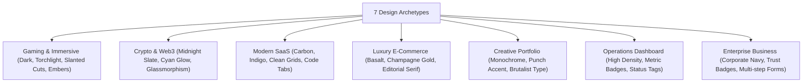

# 🚀 Antigravity Custom Skills Suite

A production-grade collection of autonomous AI engineering skills for **Google Antigravity (AGY)**, specializing in high-fidelity website reverse engineering, pixel-perfect replication, and autonomous from-scratch web application architecture.

---

## 📦 Included Skills

| Skill | Description | Primary Use Case |
| :--- | :--- | :--- |
| **[`autonomous-website-architect`](./skills/autonomous-website-architect)** | **Dual-Mode Architect**: (1) Reference-based replication from URLs/screenshots, and (2) Autonomous from-scratch design across 7 archetypes. | Complete website creation, product design, landing pages, and web apps from ideas or references. |
| **[`pixel-perfect-website-replica`](./skills/pixel-perfect-website-replica)** | **Replication Specialist**: Dedicated reverse engineering engine for exact visual cloning, asset mapping, and multi-viewport diffing. | Strict 1:1 cloning of existing websites, UI screenshots, and downloaded asset directories. |

---

## 🛠️ Prerequisites: What Needs to Be Installed

To ensure these skills operate at maximum capability, your local environment should have the following dependencies installed and configured:

### 1. Node.js & Package Manager (Essential)
- **Node.js**: `v18.0.0` or higher (tested with Node `v22+` and `v24+`).
- **npm** (comes with Node), **pnpm**, or **yarn**.
- *Why it's needed*: The skills build and launch local development servers (Vite, Next.js, React) to compile code and perform live browser verification.
- *Verify*:
  ```bash
  node -v
  npm -v
  ```

### 2. Python 3.8+ (Essential)
- **Python**: Standard library Python 3.8+ (no `pip install` required!).
- *Why it's needed*: Runs the built-in helper scripts:
  - `asset_analyzer.py`: Automatically inspects image dimensions, aspect ratios, alpha transparency, and sprite sheets.
  - `design_token_generator.py`: Scaffolds cohesive CSS variables for 7 design archetypes.
- *Verify*:
  ```bash
  python --version
  ```

### 3. Browser Automation / MCP Tools (Crucial for Verification)
- **Playwright MCP** or **Chrome DevTools MCP**:
  - *Why it's needed*: The skills enforce a **mandatory browser testing phase**. Antigravity uses Playwright / Chrome DevTools to navigate to `http://localhost:5173/`, resize the browser window across 5 viewport breakpoints (1440px, 1280px, 768px, 390px, 360px), take full-page screenshots, check for horizontal overflow, and audit console errors.
  - *Setup*: Configured automatically when the `playwright` or `chrome-devtools` MCP server is enabled in Antigravity.

### 4. Git (Recommended)
- Used for version control, branching, and pushing completed projects to GitHub.
- *Verify*:
  ```bash
  git --version
  ```

---

## 💻 Installation Guide

You can install these skills globally (available across all projects on your machine) or per-project.

### Method 1: Global Installation (Recommended)

#### On Windows (PowerShell):
Run the included one-click installer:
```powershell
.\install.ps1
```
*(Manually copies skills into `C:\Users\<YourUser>\.gemini\config\skills\`)*

#### On macOS / Linux (Bash):
Run the installer script:
```bash
chmod +x install.sh
./install.sh
```
*(Manually copies skills into `~/.gemini/config/skills/`)*

---

### Method 2: Project-Level Installation
To include these skills directly within a specific repository (so anyone cloning the project has them):
1. Create an `.agents/skills` directory at your project root:
   ```bash
   mkdir -p .agents/skills
   ```
2. Copy the skill folders into it:
   ```text
   your-project/
   └── .agents/
       └── skills/
           ├── autonomous-website-architect/
           └── pixel-perfect-website-replica/
   ```

---

### Method 3: Download Zip Packages
Pre-packaged `.zip` archives are provided in the [`packages/`](./packages) folder:
- [**`autonomous-website-architect.zip`**](./packages/autonomous-website-architect.zip)
- [**`pixel-perfect-website-replica.zip`**](./packages/pixel-perfect-website-replica.zip)

---

## 🎯 How to Trigger the Skills

Antigravity uses **progressive disclosure**. Once installed, the skills activate automatically based on your prompt:

### Mode A: Website Replication Prompts
- *"Clone this website: https://example.com"*
- *"Make an exact replica of this website using my downloaded assets folder."*
- *"Recreate this website from this full-page screenshot."*
- *"Make this website pixel-perfect."*
- *"Ei website ta same to same baniye dao."*
- *"Screenshot dekhe website ta recreate koro."*

### Mode B: Autonomous Creation Prompts
- *"Build me a complete website for an AI trading platform."*
- *"Create an e-commerce website for artisanal coffee from scratch."*
- *"Design and build a landing page for my developer tools startup."*
- *"Amar jonno ekta website baniye dao."*
- *"Screenshot chara nijer moto ekta high-end gaming website design koro."*

---

## 🎨 Autonomous Design Archetypes (Mode B)

When creating a website from an idea without visual references, the architect selects from 7 distinctive design archetypes:



---

## 🔬 Built-In Scripts Reference

### 1. `asset_analyzer.py`
Inspects local asset directories recursively, extracts dimensions, aspect ratios, checks alpha transparency, computes SHA-256 hashes, and flags sprite sheets:
```bash
python skills/autonomous-website-architect/scripts/asset_analyzer.py <path_to_assets>
```

### 2. `design_token_generator.py`
Generates cohesive CSS custom properties (colors, typography, radii, cut geometry, glows) for any archetype:
```bash
python skills/autonomous-website-architect/scripts/design_token_generator.py saas
# Options: gaming, web3, saas, ecommerce, portfolio, dashboard, business
```

---

## 🛡️ Quality Assurance Standards

Every website produced by these skills must satisfy:
1. **Zero Horizontal Overflow**: `document.documentElement.scrollWidth <= window.innerWidth` across all viewports.
2. **5-Viewport Responsive Matrix**: Tested at `1440px` (Desktop), `1280px` (Laptop), `768px` (Tablet), `390px` (Mobile), and `360px` (Small Mobile).
3. **Zero Console Errors**: 0 uncaught runtime exceptions and 0 broken asset `404` errors.
4. **Clean Production Build**: `npm run build` succeeds with zero TypeScript / bundler errors.

---

## 📄 License
MIT License. Free for personal, commercial, and open-source use.
