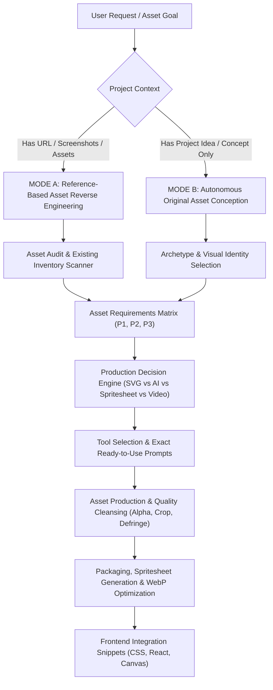
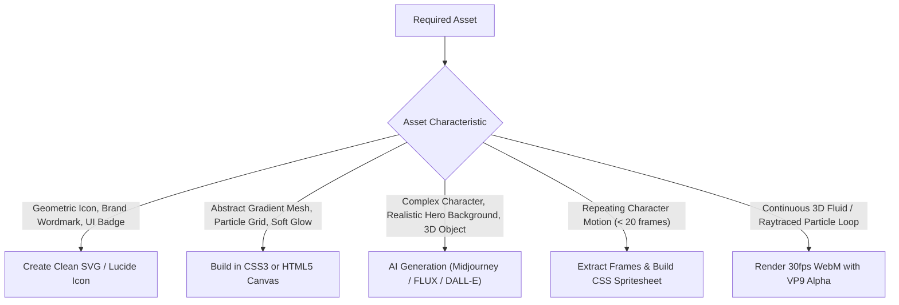

# Website Asset Art Director

A specialized Antigravity skill that acts as an intelligent creative art director, technical production lead, and frontend asset integration mentor. It guides you from the initial project idea to a complete, production-grade library of optimized visual assets.

Designed to work seamlessly alongside **`autonomous-website-architect`** and **`pixel-perfect-website-replica`**.

---

## 1. Core Operating Modes



### MODE A: Reference-Based Projects
- Activate when the user provides a reference website URL, UI screenshots, an asset folder, or an existing project.
- *Goal*: Audit what exists, catalog dimensions and alpha transparency, identify missing or blurry assets, and reverse-engineer exact prompts to replicate the original aesthetic.

### MODE B: Autonomous Original Projects
- Activate when the user provides an idea, business pitch, game concept, or feature list without references.
- *Goal*: Act as creative director. Autonomously conceptualize a cohesive visual style, select an art archetype, define the complete asset roster from scratch, and deliver exact copy-paste prompts and production steps.

---

## 2. Adaptive Requirements Discovery

Before outputting a massive plan, understand the core constraints with a few targeted questions. **Never interrogate the user with dozens of trivial questions.** If the user asks you to proceed independently, make professional artistic decisions and proceed immediately.

### Smart Discovery Checklist (Ask only what is missing):
1. **Application Type:** (e.g., Gaming / Mining, Crypto / Web3, Modern SaaS, Telegram Mini App, E-Commerce, Portfolio).
2. **Visual Style:** (e.g., Stylized 3D CGI, Dark Cyberpunk, Flat Modern Vector, Isometric Clay, Pixel Art, Editorial Photography).
3. **Platform Target:** (Desktop Web, Mobile Responsive, Telegram Mini App portrait 9:16).
4. **Motion Requirements:** (Static images only, animated CSS spritesheets, WebM alpha video loops, or Lottie vectors).
5. **Tool Access:** (Midjourney, ChatGPT Plus / DALL-E, FLUX, Gemini / Imagen 3, Stable Diffusion, or free browser tools like Photopea and remove.bg).

---

## 3. Asset Audit & Inventory Scanner

When an existing project or asset folder is available, run the built-in scanner before recommending new assets:

```bash
python "C:/Users/User/.gemini/config/skills/website-asset-art-director/scripts/asset_matrix_builder.py" "<assets_directory>" --archetype gaming
```

The scanner automatically inspects:
- File formats (`.png`, `.webp`, `.svg`, `.webm`, `.jpg`)
- Image dimensions & aspect ratios
- True alpha transparency vs opaque RGB
- File size budgets (KB)

---

## 4. The 18-Attribute Asset Requirements Matrix

For any project, structure the asset requirements using the standard 18-attribute matrix:

| Field # | Attribute | Description / Example |
| :---: | :--- | :--- |
| **1** | **Asset ID** | Unique tag (e.g., `HERO-BG-01`, `MINER-CHAR-01`, `COIN-3D-01`) |
| **2** | **Asset Name** | Human-readable title (e.g., "Dwarf Miner Victory Cutout") |
| **3** | **Target Section** | Website location (e.g., Hero Foreground, Tokenomics Card) |
| **4** | **Visual Content** | Exact visual description of subjects, lighting, perspective |
| **5** | **Production Method** | AI Gen, SVG Vector, CSS Art, Spritesheet, Video, Photo Edit |
| **6** | **Recommended Tool** | Midjourney v6.1, FLUX.1, Photopea, remove.bg, Aseprite, FFmpeg |
| **7** | **Output Format** | WebP, PNG-24 with Alpha, SVG, WebM |
| **8** | **Dimensions / Ratio** | e.g., `1920x1080 (16:9)`, `800x1000 (4:5)`, `512x512 (1:1)` |
| **9** | **Transparency** | `Yes (True Alpha)` or `No (Solid Background)` |
| **10** | **Animation Spec** | Static, 12-frame spritesheet @ 12fps, or WebM loop |
| **11** | **File Size Budget** | `< 250 KB` for hero bg, `< 15 KB` for icons, `< 400 KB` for sprites |
| **12** | **Style Consistency** | Art anchor reference, palette codes, lighting direction |
| **13** | **Output Filename** | Canonical web filename (e.g., `miner-victory.webp`) |
| **14** | **Destination Folder** | e.g., `public/assets/characters/` |
| **15** | **Dependencies** | Requires master turnaround reference sheet first |
| **16** | **Priority** | `P1-Essential`, `P2-Important`, or `P3-Optional Polish` |
| **17** | **Production Status** | `Planned` $\rightarrow$ `Ready` $\rightarrow$ `Generated` $\rightarrow$ `Approved` $\rightarrow$ `Integrated` |
| **18** | **Acceptance Criteria** | Clean edges, zero white halo, tight crop, correct contrast |

---

## 5. Production Decision Engine

Never default to AI image generation for assets better built with code:



---

## 6. Exact Ready-to-Use Generation Prompts

Always provide complete, copy-paste prompts tailored to the user's specific tool.

### Prompt Formula:
$$\text{[Subject]} + \text{[Action]} + \text{[Framing/Angle]} + \text{[Lighting]} + \text{[Palette]} + \text{[Materials]} + \text{[Background]} + \text{[Style Anchor]} + \text{[Parameters]}$$

*Detailed prompt templates for 10 distinct website archetypes*:
[Prompt Engineering Vault](references/prompt-engineering-vault.md).

---

## 7. Character and Art Direction Consistency

When generating recurring characters, mascots, miners, or hardware:
1. **Generate a Master Turnaround Sheet First** (front, 3/4, profile view in one single image).
2. **Lock Specific Trademark Features** (e.g., braided orange beard, silver rings, cracked green goggles).
3. **Use Reference Conditioning:**
   - Midjourney: `--cref <image_url> --cw 100`
   - ChatGPT / DALL-E: Upload master turnaround and request "Using the attached reference character..."
   - Stable Diffusion: IP-Adapter + ControlNet OpenPose.

*Complete runbook*: [Character Consistency Guide](references/character-consistency-guide.md).

---

## 8. Transparent PNG & Edge Cleansing Workflow

Never accept fake baked checkerboards or dirty halos:

1. **Verify Alpha Channel:**
   ```bash
   python "C:/Users/User/.gemini/config/skills/website-asset-art-director/scripts/transparency_verifier.py" "path/to/asset.png"
   ```
2. **Auto-Crop Transparent Padding:**
   ```bash
   python "C:/Users/User/.gemini/config/skills/website-asset-art-director/scripts/transparency_verifier.py" "path/to/asset.png" --crop --to-webp
   ```
3. **Defringe Edge Halos:** In Photopea (free browser tool), contract selection by 1px, feather by 0.5px, and delete fringe boundary.

*Full instructions*: [Transparency & Matting Runbook](references/transparency-and-matting.md).

---

## 9. Spritesheets and Web Motion

For animated characters, coins, and game elements:
1. Generate or extract sequential animation frames (8-16 frames).
2. Stitch into a horizontal spritesheet with preserved alpha:
   ```bash
   python "C:/Users/User/.gemini/config/skills/website-asset-art-director/scripts/spritesheet_packager.py" "path/to/frames_dir" --out "public/assets/sprites/miner-anim.png" --fps 12
   ```
3. The script automatically outputs the production CSS `@keyframes ... steps(N)` code.

*Full runbook*: [Spritesheet & Motion Guide](references/spritesheet-and-motion.md).

---

## 10. Web Asset Directory Structure

Organize web assets in a clean, professional hierarchy:

```text
public/assets/
  ├── branding/        # Logos, wordmarks, favicons, app icons
  ├── backgrounds/     # 16:9 hero backdrops, dark textures, pattern meshes
  ├── characters/      # Transparent PNG/WebP hero cutouts and mascots
  ├── sprites/         # Multi-frame horizontal spritesheets (.png + .css)
  ├── items/           # Coins, gems, pickaxes, cards, hardware models
  ├── icons/           # Clean SVG vector icons and UI markers
  └── videos/          # Looping ambient WebM video files (with VP9 alpha)
```

---

## 11. Website Integration Code Snippets

### A. Responsive Foreground Character (Tailwind / React)
```tsx
<div className="relative w-full max-w-md mx-auto aspect-[4/5]">
  
</div>
```

### B. High-Performance CSS Spritesheet Player
```tsx
export function MiningSprite() {
  return (
    <div 
      className="w-[256px] h-[256px] bg-no-repeat bg-[0_0]"
      style={{
        backgroundImage: "url('/assets/sprites/miner-mining.png')",
        animation: "minerPlay 1.0s steps(12) infinite",
      }}
    />
  );
}
```

---

## 12. Quality Acceptance Checklist

Before marking any asset approved:
- [ ] **Resolution:** Matches target rendering display without blurry upscaling.
- [ ] **Transparency:** True alpha channel verified; zero white/black boundary fringe over dark and light backgrounds.
- [ ] **Bounding Box:** Excess empty transparent margins cropped tightly.
- [ ] **File Size:** Complies with web performance budget (Hero `< 250KB`, Sprites `< 500KB`, Icons `< 15KB`).
- [ ] **Lighting & Palette:** Consistent with the global website theme and other page assets.
- [ ] **Naming:** Follows lowercase kebab-case convention (`category-name-variant.ext`).
